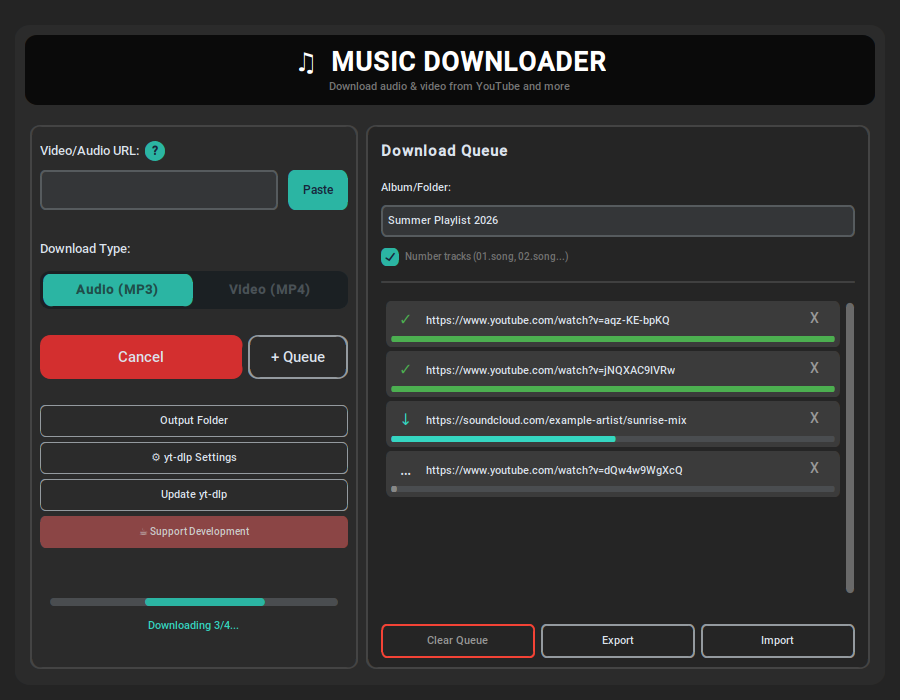
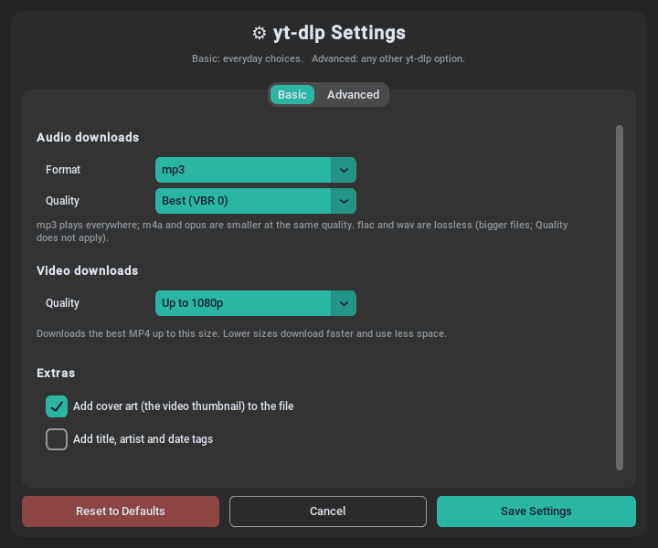

# 🎵 MDJ Music Downloader

A modern, easy-to-use desktop application for downloading audio and video from YouTube and 1000+ websites.

> **Use it responsibly:** only download content you have the right to download – your own uploads, Creative Commons or public-domain works, or content the owner allows you to download. See [Legal and responsible use](#legal).



## 🎬 Demo

https://github.com/user-attachments/assets/6b4f6965-2db1-4ee1-baed-48ecad48eee8

▶️ [Watch on Vimeo](https://vimeo.com/1245638057)

## ✨ Features

- 🎵 **Audio & Video Downloads** - MP3, M4A, Opus, FLAC or WAV audio, and MP4 video up to 4K
- ⚙️ **yt-dlp Settings** - Everyday choices on the Basic tab; any yt-dlp option on the Advanced tab, with a Check button and a live preview of the exact command
- 📋 **Numbered Download Queue** - Add many links and download them in order (1., 2., 3. ...)
- 📁 **Album Folders** - Name an album and its songs go into their own folder
- 🔢 **Smart Track Numbering** - 01.Song, 02.Song... and adding songs later continues the numbers
- 🖼️ **Cover Art & Tags** - Square covers and title, artist, album and track tags that music players, phones and car stereos understand, plus a `cover.jpg` for each album folder
- ⏭️ **No Duplicates** - Songs you already have are skipped
- 🎼 **Playlist Generation** - Auto-creates .m3u playlist files
- 💾 **Queue Export/Import** - Save a queue as `<album>.txt` and load it again later; Import fills in the album name
- 🧾 **Clear Error Messages** - A short reason in the status line and a **Details** button with the full message and a **Copy** button, for asking for help
- 📂 **Open Folder in One Click** - Click the folder path shown after "Saved to:" when a download finishes
- 🖥️ **Multi-Monitor Support** - Proper window positioning
- 👥 **Multi-User Ready** - Each user gets their own settings
- 🎨 **Modern Interface** - Clean, professional CustomTkinter UI
- 🔄 **Built-in yt-dlp Updater** - Update downloader without reinstalling (for all users with an admin password, or just for yourself without one)

## 🎯 Why MDJ Music Downloader?

Unlike other downloaders, MDJ Music Downloader is specifically designed for music collectors:
- **Smart numbering** removes existing track numbers ("1.Song") but keeps natural numbers ("1 Hour Mix")
- **Automatic playlists, covers and tags** so you can copy albums directly to your MP3 player, phone or car stereo
- **Clean, focused UI** - not bloated with features you don't need
- **Queue system** for batch downloading entire albums

## 📥 Installation

### From Package (Recommended – Ubuntu/Debian/Linux Mint)
1. Download `mdj-music-downloader_1.1.3_amd64.deb` from the [Releases](https://github.com/ngquocvuong/mdj-music-downloader/releases) page
2. Install it:
   ```bash
   sudo apt install ./mdj-music-downloader_1.1.3_amd64.deb
   ```
3. Launch **MDJ Music Downloader** from your application menu

Uninstall: `sudo apt remove mdj-music-downloader`

### From Source
See [INSTALL.md](INSTALL.md).

### Flatpak (build it yourself)
MDJ is not on Flathub. If you prefer a Flatpak, with yt-dlp, ffmpeg and Node.js included, see [flatpak/README.md](flatpak/README.md).

### Requirements
- 64-bit Linux (Ubuntu 22.04+, Linux Mint 21+, Debian 12+, Pop!_OS 22.04+, or equivalent – glibc 2.35 or newer)
- ffmpeg (installed automatically by the .deb package)
- Python, yt-dlp and Deno (which yt-dlp needs for YouTube) are bundled – nothing else to install

## 🎬 Usage

1. **Paste a link** - Copy a YouTube (or other site) link and click **Paste**
2. **Download now, or + Queue** - Download one song, or build a numbered list
3. **Set Album/Folder** (optional) - Songs go into their own album folder
4. **Number tracks** (optional) - Songs are saved as 01.Song, 02.Song...
5. **Click Download Queue** - Sit back and relax!

### Tips:
- The queue order is the album order when "Number tracks" is on. Adding songs to an existing album later continues the numbers (`01`, `02` → `03`).
- Songs already in the folder are skipped, so you can safely retry a playlist.
- A link to one song inside a playlist downloads only that song.
- **Export** saves the queue as a .txt file named after the album (e.g. `Summer Hits.txt`); **Import** loads it and fills in the album name. Good for backups and sharing.
- Playlists (.m3u) work on most MP3 players and media software.
- If a download fails, click **Details** next to the message to see everything, and **Copy** to paste it into a bug report.
- File names work on USB sticks and SD cards too: characters they don't allow are replaced (the title tag keeps the real title).

## ⚙️ Configuration (Optional)

**No config file needed!** The app works out-of-the-box with sensible defaults.

### Customizing yt-dlp Settings

Click "⚙ yt-dlp Settings":

- **Basic tab:** audio format (mp3, m4a, opus, flac, wav) and quality, video quality (best, 4K, 1440p, 1080p, 720p, 480p), cover art and tags (on by default), and your browser's login (cookies) for age-restricted videos.
- **Advanced tab:** any yt-dlp option, with step-by-step help, a **Check** button that asks yt-dlp whether it accepts your options, and a live preview of the exact command the app will run. When a custom option changes a Basic setting, the custom option wins and the Basic control is locked with a note.
- **Reset to Defaults** brings back the original settings.



**Config File Location:** `~/.config/mdj-music-downloader/config.json` (auto-created when you change settings). In the Flatpak: `~/.var/app/io.github.ngquocvuong.mdj-music-downloader/config/mdj-music-downloader/config.json`.

**Sample Config:** See [`config.sample.json`](config.sample.json) for reference

**Detailed Guide:** See [`CONFIG_GUIDE.md`](CONFIG_GUIDE.md) for all options

### Common Customizations

```bash
# Use your own Firefox login (for videos your account can watch)
--cookies-from-browser firefox

# Limit download speed
--limit-rate 500K

# Use proxy
--proxy socks5://127.0.0.1:1080
```

## 🛠️ Built With

- **[Python](https://www.python.org/)** - Programming language
- **[CustomTkinter](https://github.com/TomSchimansky/CustomTkinter)** - Modern UI framework
- **[yt-dlp](https://github.com/yt-dlp/yt-dlp)** - Download engine (powers the downloads)
- **[Deno](https://deno.com/)** - JavaScript runtime that yt-dlp uses for YouTube
- **[mutagen](https://github.com/quodlibet/mutagen)** - Writes the cover art and tags

## 📜 License

MDJ Music Downloader's source code is licensed under the MIT License - see the [LICENSE](LICENSE) file for details.

The `.deb` package also contains software made by others (yt-dlp, Deno, Python, CustomTkinter, mutagen and more), each under its own license. Some of these parts are GPL-licensed, so the packaged program as a whole is distributed under the GPL-3.0-or-later; all of its source code is available. See [THIRD_PARTY_NOTICES.md](THIRD_PARTY_NOTICES.md) for the full list, the license texts and where to get the source. The package installs this file in `/usr/share/doc/mdj-music-downloader/`.

## 💖 Support Development

If MDJ Music Downloader saves you time and you'd like to support its development:

[](https://ko-fi.com/mdj_musicdl)

**Other ways to support:**
- ⭐ Star this project on GitHub
- 🐛 Report bugs and request features
- 📢 Share with friends who need it
- 💬 Leave a review

All donations help maintain and improve MDJ Music Downloader!

## 🤝 Contributing

Contributions are welcome! Feel free to:
- Report bugs via [Issues](https://github.com/ngquocvuong/mdj-music-downloader/issues)
- Suggest features
- Submit pull requests

## 📞 Contact

- **Issues**: [GitHub Issues](https://github.com/ngquocvuong/mdj-music-downloader/issues)
- **Email**: blackhawk_7585@icloud.com (for private inquiries)

<a name="legal"></a>

## ⚖️ Legal and responsible use

MDJ Music Downloader is a general-purpose tool, like a web browser or a screen recorder. What you download with it, and whether you are allowed to, is your responsibility.

**Only download content you have the right to download**, for example:
- videos and music you made and uploaded yourself
- works under a Creative Commons license that allows it, or in the public domain
- content whose owner gives you permission to download it

**Please respect the rules:**
- **Copyright:** most music and videos online are protected by copyright. Downloading them without the owner's permission may be illegal where you live, even for personal use. The laws differ from country to country.
- **Terms of service:** websites have their own rules. YouTube's Terms of Service, for example, do not allow downloading unless YouTube shows a download button or link, or YouTube gives you written permission. Read the terms of each site you use.
- **Don't share or sell** what you download unless you have the rights to do so.

**What MDJ does not do:**
- It does not break DRM or copy protection, and it does not download from paid streaming services that use them (such as Spotify, Apple Music, Netflix or Disney+).
- It does not get around paywalls, logins or region locks. If you choose to sign in with your browser's cookies, it only uses your own account, with the access that account already has.
- It does not host, store, index or share any content. Everything is downloaded directly from the site to your own computer.

**No affiliation:** MDJ Music Downloader is an independent project. It is not affiliated with, endorsed by or sponsored by YouTube, Google or any other website it works with. All product names, logos and brands belong to their owners and are used only to describe compatibility.

**No warranty:** the software is provided "as is", without warranty of any kind (see [LICENSE](LICENSE)). The authors are not responsible for how it is used.

**Rights holders:** if you believe this project itself (its code, documentation or images) infringes your rights, please contact blackhawk_7585@icloud.com and it will be looked at promptly.

## 🙏 Acknowledgments

- **yt-dlp team** for the amazing download engine
- **Blender Foundation** for the Creative Commons films used in the screenshots and demo videos
- **CustomTkinter** for the beautiful UI framework
- **All contributors and supporters** who make this project possible

---

Made with ❤️ for the Linux community
